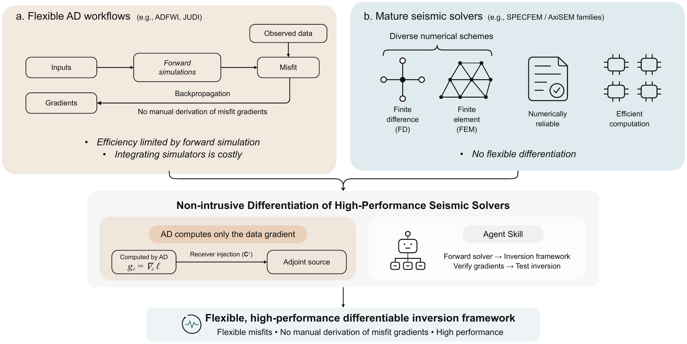
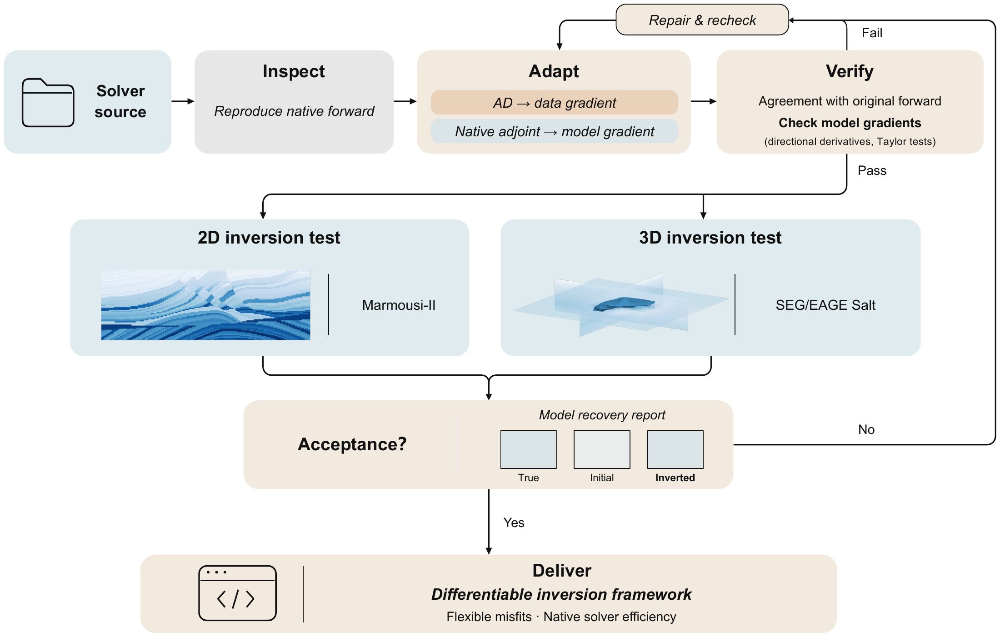

# SeismicDiffSkill

**Authors** Xi Wang, Zhanwen Li, and Xin Liu (corresponding author)

Department of Earth and Planetary Sciences, The University of Hong Kong

SeismicDiffSkill is a reusable Agent Skill that guides a coding agent through adding
a differentiable inversion interface to an existing high-performance seismic
forward solver. Automatic differentiation (AD) computes the derivative of
the misfit with respect to the synthetic receiver traces, including any
waveform preprocessing. The solver applies the transpose of receiver sampling
to inject this derivative as the adjoint source. It computes the model gradient
from the forward and adjoint wavefields using its native kernels and parallel execution.



*Differentiating native seismic solvers.*

## Companion inversion software

We used the Agent Skill to develop two standalone inversion packages. Each
builds its native solver and supports user-defined differentiable receiver
misfits. The examples invert for Vp and write an HTML recovery report.
Vp is the Skill's default recovery target. You can
adapt the Skill to test another parameter supported by your solver, such as
Vs or density.

Both the 2D and 3D inversions use **debiased soft-DTW divergence** as the
waveform misfit. We chose it because deriving its adjoint source by hand
requires differentiating through many possible time alignments, both between
the synthetic and observed traces and between each synthetic trace and itself.
Each example averages the trace losses within each shot. At the same current
model, it sums the shot losses and their model gradients, divides both sums
by the total number of shots, and updates the model once.

### DiffSPECFEM2D · 2D Marmousi-II

Native SPECFEM2D propagates elastic P–SV waves in Fortran. The paper and
software use the University of Houston AGL download edition of Marmousi-II.
On first use, the software downloads Vp, Vs and density and builds the
68 × 200 model and Gaussian-smoothed starting Vp locally.
The inversion uses all 40 shots in each of its 300 updates.
The example writes the true, initial and
inverted Vp panels and the loss curve to a local HTML report. [DiffSPECFEM2D repository](https://github.com/Wangxi404/DiffSPECFEM-native)


Marmousi-II by Gary S. Martin, Robert Wiley and Kurt J. Marfurt.
[AGL downloads](https://www.agl.uh.edu/downloads/downloads.htm) · [Model preparation](docs/model-data.md#marmousi-ii)

### DiffAxiSEM3D · 3D SEG/EAGE Salt

Native AxiSEM3D propagates 3D elastic waves in C++ with MPI. The inversion
uses all 9 shots in each of its 125 updates on the 33 × 33 × 17 grid. [DiffAxiSEM3D repository](https://github.com/Wangxi404/DiffAxiSEM3D-native)


Salt model © 1997 Society of Exploration Geophysicists (Aminzadeh, Brac and
Kunz). We resampled the model and smoothed Vp for the initial condition.
[SEG dataset](https://wiki.seg.org/wiki/SEG/EAGE_Salt_and_Overthrust_Models) · [CC BY 4.0](https://creativecommons.org/licenses/by/4.0/)

## Use the skill with another solver

Clone this repository alongside your solver checkout.

```bash
git clone https://github.com/Wangxi404/differentiate-seismic-solver.git
```

From the directory containing both checkouts, tell your coding agent which
parameter you want to recover. Use Vp for the default test. For a custom Vs
test with an elastic solver, for example, you can use this prompt:

> Follow `./differentiate-seismic-solver/skills/differentiate-seismic-solver/SKILL.md`
> to adapt `./my-solver`. Start from `./my-solver/examples/elastic`.
> Adapt the recovery test to invert for Vs with Vp and density held fixed.
> Reuse or implement the Vs sensitivity kernel and verify the Vs gradient.
> Run the inversion and generate the model-recovery report.

The Skill first checks that the adapted solver reproduces the original forward
data. To test a model gradient, the agent compares its inner product with a
chosen direction to a centered finite difference along that direction. When
the misfit is a sum or a mean over shots, the gradient check and the inversion
use the same normalization.
[Skill instructions](skills/differentiate-seismic-solver/SKILL.md) · [Frozen file hashes](manifest.json)



*Agent Skill workflow.*

The skill code is MIT licensed. Model data have their own terms.
[Code license](LICENSE) · [Model data and figure rights](docs/model-data.md)

This product includes color specifications and designs developed by Cynthia Brewer
(http://colorbrewer.org/). [ColorBrewer license](skills/differentiate-seismic-solver/assets/LICENSE.colorbrewer)
