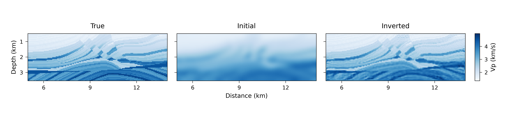
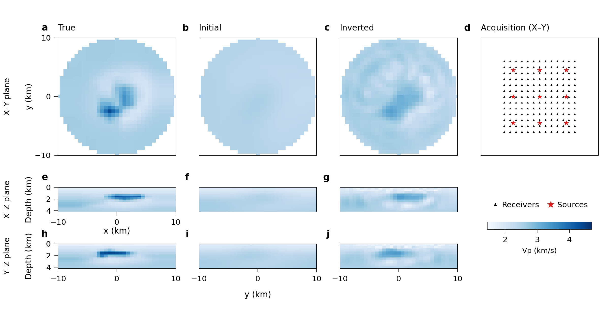

# SeismicDiffSkill

SeismicDiffSkill is a reusable Agent Skill that guides a coding agent through adding
a differentiable inversion interface to an existing high-performance seismic
forward solver. Wave propagation and parallel execution stay in the native
solver. Automatic differentiation of the receiver
misfit supplies the adjoint source. A discrete adjoint and the model-parameter
derivatives turn that source into a model gradient.

## Companion inversion software

We used the Agent Skill to develop two standalone inversion packages.
Each builds a native solver, runs a full-shot Vp inversion and writes an HTML
report. Both support a user-defined differentiable receiver misfit.

### DiffSPECFEM-native · 2D Marmousi-II

Native SPECFEM2D propagates elastic P–SV waves in Fortran. The paper and
software use the University of Houston AGL download edition of Marmousi-II.
On first use, the software downloads Vp, Vs and density and builds the
68 × 200 model and Gaussian-smoothed starting Vp locally.
With all 40 shots in each update, whole-model Vp RMSE fell from **362 to
191 m/s** after 300 updates. The example writes the true, initial and
inverted Vp panels and the loss curve to a local HTML report.
[Run the inversion and generate the figures](https://github.com/Wangxi404/DiffSPECFEM-native#run-the-example)



Marmousi-II by Gary S. Martin, Robert Wiley and Kurt J. Marfurt.
[AGL downloads](https://www.agl.uh.edu/downloads/downloads.htm) · [Model preparation](docs/model-data.md#marmousi-ii)

### DiffAxiSEM3D-native · 3D SEG/EAGE Salt

Native AxiSEM3D propagates 3D elastic waves in C++ with MPI. After 125
updates with all 9 shots, Vp RMSE within the simulated cylinder fell from
**201 to 166 m/s** on the 33 × 33 × 17 grid.
[Software and run instructions](https://github.com/Wangxi404/DiffAxiSEM3D-native#run-the-example)



Salt model © 1997 Society of Exploration Geophysicists (Aminzadeh, Brac and
Kunz). We resampled the model and smoothed Vp for the initial condition.
[SEG dataset](https://wiki.seg.org/wiki/SEG/EAGE_Salt_and_Overthrust_Models) · [CC BY 4.0](https://creativecommons.org/licenses/by/4.0/)

## Use the skill with another solver

Clone this repository alongside your solver checkout.

```bash
git clone https://github.com/Wangxi404/differentiate-seismic-solver.git
```

From the directory containing both checkouts, give your coding agent a request
like this one.

> Follow `./differentiate-seismic-solver/skills/differentiate-seismic-solver/SKILL.md`
> to adapt `./my-solver`. Start from `./my-solver/examples/elastic`.
> Add a Vp inversion, verify the model gradient, and generate the model-recovery report.

The skill checks native-forward equivalence and model gradients, accumulates
all shot gradients at the same current model before each update, and produces
an English recovery report. [Skill instructions](skills/differentiate-seismic-solver/SKILL.md) · [Frozen file hashes](manifest.json)

The skill code is MIT licensed. Model data have their own terms.
[Code license](LICENSE) · [Model data and figure rights](docs/model-data.md)

This product includes color specifications and designs developed by Cynthia Brewer
(http://colorbrewer.org/). [ColorBrewer license](skills/differentiate-seismic-solver/assets/LICENSE.colorbrewer)
